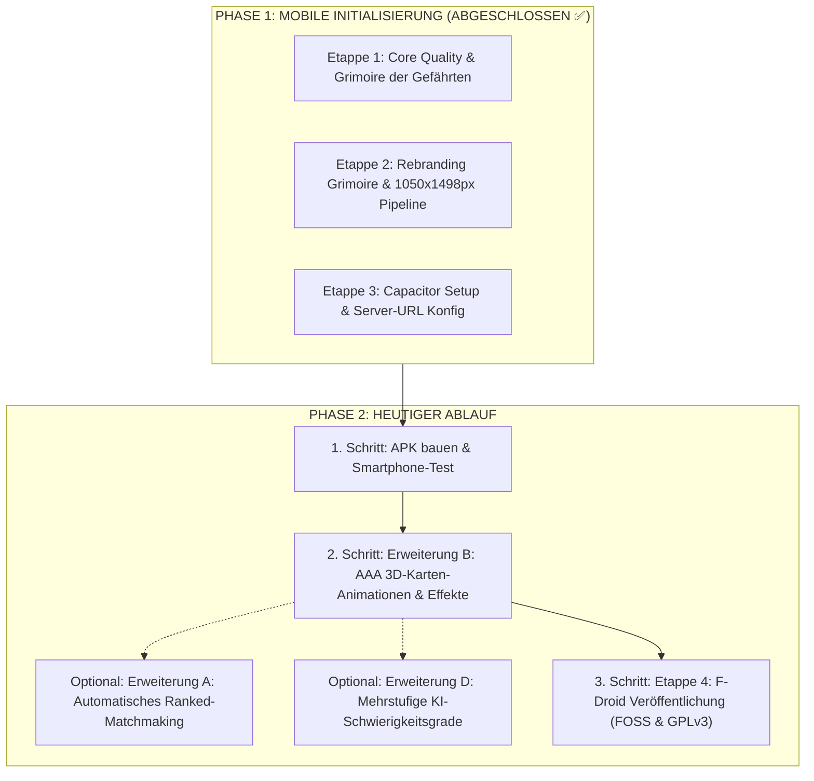

# Grimoire Online – Projekt-Roadmap & Arbeitsstand

> **STATUS HEUTE**:  
> 1. **Schritt 1**: Android APK bauen & auf Smartphone testen  
> 2. **Schritt 2**: Gameplay- & Visual-Polish (Erweiterung B: AAA 3D-Karten-Animationen & Partikeleffekte / Erweiterung A: Ranked Matchmaking)  
> 3. **Schritt 3**: F-Droid Veröffentlichung (Etappe 4: FOSS-Metadaten, GPLv3-Lizenz, Fastlane)

---

## 📱 Detaillierte Anleitung: Android APK bauen & auf dem Smartphone testen

1. **Android Studio installieren (falls noch nicht geschehen)**:
   - Von [developer.android.com/studio](https://developer.android.com/studio) herunterladen und mit Standardeinstellungen installieren.
2. **Projekt in Android Studio öffnen**:
   ```powershell
   npm run cap:open:android
   ```
   *(Alternativ: Android Studio öffnen ➔ `Open` ➔ Ordner `C:\Users\Jamin\Documents\wizard-game\android` wählen).*
3. **Gradle Sync abwarten**:
   - Beim ersten Öffnen lädt Android Studio kurz im Hintergrund die nötigen Gradle-Plugins herunter (ca. 1–2 Min., bis unten *"Gradle build finished"* steht).
4. **APK kompilieren**:
   - In Android Studio oben im Menü: **Build** ➔ **Build Bundle(s) / APK(s)** ➔ **Build APK(s)**.
5. **APK-Datei finden**:
   - Nach ca. 30–60 Sekunden erscheint unten rechts ein Pop-up mit dem blauen Link **`locate`**.
   - Die fertige Datei liegt unter:  
     `android/app/build/outputs/apk/debug/app-debug.apk`
6. **Auf dein Handy übertragen & installieren**:
   - Übertrage `app-debug.apk` per USB-Kabel, Nextcloud, Google Drive, WhatsApp Web, Telegram oder Signal auf dein Smartphone und tippe auf **Installieren**.
7. **Spielserver auf dem PC starten**:
   ```powershell
   npm start
   ```
   *(Wichtig: Dein PC und dein Smartphone müssen im selben WLAN sein).*
8. **Server-Adresse in der App verbinden**:
   - Deine aktuelle PC-WLAN-IP ist: **`192.168.188.162`**
   - Öffne die **Grimoire**-App auf dem Smartphone.
   - Tippe oben rechts auf das Zahnrad-Symbol **`⚙️ Server`**.
   - Trage ein: **`http://192.168.188.162:3000`** und tippe auf **`⚔️ Speichern & Verbinden`**.
   - Schon bist du voll vernetzt und kannst mit Haptik, Safe-Areas und flüssigen Touch-Gesten spielen!

---

## 🧭 Master-Fahrplan & Aktuelle Reihenfolge



---

## 📌 Phase 1: Abschluss von Etappe 3 (ABGESCHLOSSEN ✅)

* [x] **Aufgabe 3.1: Server-URL Konfiguration für mobile Endgeräte**
  - In `public/client.js` Server-URL dynamisch ermitteln: Im Browser `window.location.origin`, in Capacitor primär `localStorage.getItem('grimoire_server_url')`.
  - Einstellungs-Icon (⚙️) im Lobby-Header & Button im Verbindungs-Banner öffnet Dialog *"Spielserver-Verbindung"*.
  - Speicherung im `localStorage` & automatischer Reconnect.
  - Automatische Asset-Spiegelung nach `android/` via `npx cap sync`.
  - Verifiziert durch 27/27 bestandene Tests inkl. `test/mobileServerConfig.test.js`.
* [x] **Aufgabe 3.2: Git-Bereinigung & Thematische Commits**
  - Arbeitskopie (über 9.500 Zeilen Diff) in Git gesichert (Commit `60fc868`).
  - Working Tree sauber und konsolidiert.
* [x] **Aufgabe 3.3: APK-Generierung & Build-Leitfaden**
  - Android Studio öffnen via `npm run cap:open:android`.
  - APK kompilieren via *Build -> Build Bundle(s) / APK(s) -> Build APK(s)*.
  - APK-Speicherort: `android/app/build/outputs/apk/debug/app-debug.apk`.
  - Installations- und Testanleitung dokumentiert.

---

## 📌 Phase 2: Nach Wiederkehr des Entwicklers

### 1. ETAPPE 4: F-Droid Veröffentlichung (FOSS & 100% Kostenlos)
* **Lizenzierung**: Saubere Open-Source-Lizenzdatei (`LICENSE`, z. B. GPLv3 oder MIT) im Root anlegen.
* **FOSS-Audit**: Sicherstellen, dass keine proprietären Google Play Services oder proprietäre Binaries in die App eingebunden sind.
* **Fastlane-Ordnerstruktur**:
  - `metadata/de.grimoire.online/en-US/short_description.txt`
  - `metadata/de.grimoire.online/en-US/full_description.txt`
  - Smartphone-Screenshots (Filztisch, Handkarten, Grimoire).
* **F-Droid Build-Rezept**: `.fdroid.yml` für reproducible builds erstellen und Merge Request im F-Droid Data Repository vorbereiten.

### 2. ERWEITERUNG A: Automatisches Ranked-Matchmaking (1-Klick Queue)
* **Warteschlangen-System**: Spieler klicken in der Lobby auf *"Gewertete Partie suchen"*.
* **Matchmaking-Logik**: Der Server gruppiert wartende Spieler anhand ihrer Skill-Rating (SR ±200 Punkte) in einen Raum (3–6 Spieler).
* **Match-Ready-Dialog**: Akustisches Signal & 15-Sekunden Bestätigungs-Countdown vor Spielstart.

### 3. ERWEITERUNG B: Visuelles Polish & AAA 3D-Karten-Animationen
* **3D-Kartenflugbahnen**: Bezier-Kurven und Fluganimationen von Handkarte zum Spieltisch und vom Tisch zum Stichgewinner (`transform-style: preserve-3d`).
* **Partikel- & Soundeffekte**:
  - Lindwurm: Flammenhauch & Brandspuren auf dem Tisch.
  - Magiekollaps: Schockwelle & Tisch-Beben.
  - Einhorn: Sternenstaub-Aura.
* **Tisch-Lichtreflexe**: Dynamischer Schattenwurf passend zur Finger-/Maus-Position.

### 4. ERWEITERUNG C: Produktiv-Deployment & Hosting
* **Docker & Container**: `Dockerfile` und `docker-compose.yml` für schnelles Deployment.
* **SSL/WSS**: Sichere WebSocket-Verschlüsselung mit Nginx Reverse Proxy.
* **Umgebungsvariablen**: Konsequente Trennung von `.env` (Port, JWT Secret, DB-Pfad).

### 5. ERWEITERUNG D: Mehrstufige KI-Schwierigkeitsgrade (Solo- & Bot-Entwicklung)
* **Stufe 1: Novize (Lehrling - Casual & Anfänger)**:
  - Spielt nach elementaren Grundregeln (Farbbedienung, Zauberer/Narr).
  - Bietet rein nach Faustformel ohne tiefes Mitzählen gegnerischer Gebote.
  - Legt zufällige legale Karten ab, wenn die angespielte Farbe nicht bedient werden kann.
* **Stufe 2: Meister (Magier - Taktisch & Ausbalanciert)**:
  - Taktische Biet-Heuristiken unter Berücksichtigung von Trumpffarbe, Zauberern und dem Geber-Gesetz (+/- 1 Regel).
  - Farbabwurf-Strategie: Wirft gezielt hohe Fehlfarben ab, wenn das eigene Gebot bereits erfüllt ist; unterbietet Stiche mit niedrigen Zahlen.
  - Schätzt das Risiko von Narren und Scharlatanen realistisch ein.
* **Stufe 3: Erzmagier (Oberster Rat - Hardcore & E-Sport)**:
  - **Probability Tracking (Kartenzählen)**: Weiß exakt, welche Zauberer, Narren, Drachen und Trümpfe noch im Deck bzw. auf fremden Händen sein können.
  - **Sonderkarten-Perfektion**: Meistert Vorrangregeln (Lindwurm vs. Waldnymphe, Einhorn-Entzauberung gegen Magiekollaps, Schattenhexe-Ritualtausch zur Maximierung der Handkartenqualität).
  - **Sabotage-Taktik**: Erkennt führende Spieler und zerstört deren Vorhersagen durch forciertes Stiche-Übertragen.
  - **Monte-Carlo-Stichsimulation (MCTS)**: Simuliert vor jedem Ausspielen hunderte Stichverläufe für die mathematisch optimale Karte.

---

## 📜 Historie der abgeschlossenen Etappen

* ✅ **Etappe 1: Core Quality & Grimoire der Gefährten** (Abgeschlossen)
  - 0ms Auto-Login via `localStorage`
  - SQLite `friendships`-Tabelle & Socket.IO Präsenzanzeige (Zitadelle, Spiel)
  - "Grimoire der Gefährten" Drawer
  - Overwatch-Style Einladungs-Popup mit 15s Countdown-Balken & Sound (`invite-chime.wav`)
  - 26 Test-Suiten mit 100% Erfolgsquote
* ✅ **Etappe 2: Rebranding & 1050×1498 px Karten-Pipeline** (Abgeschlossen)
  - Vollständiges Dark-Fantasy Rebranding (*Grimoire – Das Magische Kartenspiel der Zitadelle*)
  - Sonderkarten: Erzmagier (`E`), Scharlatan (`S`), Lindwurm (`L`), Waldnymphe (`F`), Magiekollaps (`K`), Doppelgänger (`D`), Blutfürst (`B`), Himmelsschleier (`9¾`), Mondbestie (`M`), Schattenhexe (`X`), Taschenspieler (`7½`/`T`), Einhorn (`H`)
  - 1050 × 1498 px Bild-Architektur mit SVG-Platzhaltern in `public/images/cards/`
  - Modus-gefiltertes Regel-Grimoire mit Lore-Texten & Bestiarium
