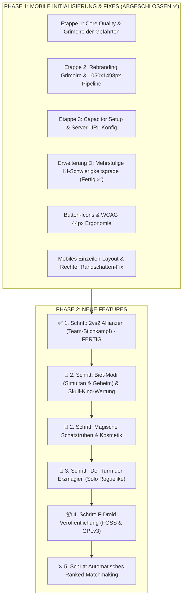

# Grimoire Online – Projekt-Roadmap & Arbeitsstand

> **FOKUS AKTUELL**:  
> 📱 **Mobile Version (Samsung Galaxy A35 5G) – Status & Verbesserungen (Vollständig gehärtet ✅)**:  
> - ✅ **Taktile Handkarten & Anschnitt unten (L39)**: Karten vergrößert auf `clamp(74px, 18.5vw, 94px)`; ruhen bei `translateY(16px)` für maximalen Tischraum und heben sich bei Tap/Hover auf `translateY(-34px) scale(1.08)` an.  
> - ✅ **Links-Start & Fächer-Überlappung (L39)**: Initialer Hand-Fokus strikt bei `scrollLeft = 0`; dynamische `-16px` Fächer-Überlappung auch im horizontal scrollenden Zustand; rechter Schattenfade signalisiert Scrollbarkeit.  
> - ✅ **Kompakte Buttons & HUD-Badges (L37)**: Alle Warteraum-, Pause- und Modalknöpfe ohne Textüberlauf einzeilig (`Partie beginnen`, `Gefährten einladen`, `Spiel gründen`, `Beitreten`); Badges `🎯`, `🏆`, `🔥`/`🌙` im In-Game HUD.  
> - ✅ **0px Overflow Garantie**: Vollbild-Drawers (`100vw`) bei $\le 480\text{px}$, `safe center` Flexbox mit Legacy-Fallback, `margin: clamp(8px, 2vh, 20px) auto` Warteraum-Fix, 42×42px Touch-Targets.  
> - ✅ **Rechter Randschatten-Fix**: Drawers im geschlossenen Zustand ohne Schattenwurf in den Viewport.  
> - ✅ **Einzeiliges Header-Layout (`flex-wrap: nowrap`)**: Kompakter `🗝️ Anmelden`-Button und feste Aktionsleiste.  
> - 🔄 **Android Sync**: Alle Assets via `npm run cap:sync` direkt in den Android-Build gespiegelt.  
> ⚔️ **Etappe 5 (2vs2 Allianzen)**: Abgeschlossen und mit 40/40 Tests verifiziert.  
> 🎁 **Nächster Schritt (Prio 2)**: **Magische Schatztruhen (Lootboxen) & Kosmetik-Progression** (Kartenrücken, Tisch-Skins, Avatar-Rahmen).  
> 🏰 **Prio 3**: **„Der Turm der Erzmagier“ (Solo-Roguelike-Kampagne)**.  
> 📦 **Prio 4**: F-Droid Veröffentlichung (Etappe 4: FOSS-Metadaten, GPLv3-Lizenz, Fastlane).  

---

## 📱 Detaillierte Anleitung: Android APK bauen & auf dem Smartphone testen

1. **Android Studio installieren (falls noch nicht geschehen)**:
   - Von [developer.android.com/studio](https://developer.android.com/studio) herunterladen und mit Standardeinstellungen installieren.
2. **Projekt in Android Studio öffnen**:
   ```powershell
   npm run cap:open:android
   ```
   *(Alternativ: Android Studio öffnen ➔ `Open` ➔ Ordner `C:\Users\Jamin\Documents\wizard-game\android` wählen).*
3. **Gradle Sync abwarten**:
   - Beim ersten Öffnen lädt Android Studio kurz im Hintergrund die nötigen Gradle-Plugins herunter (ca. 1–2 Min., bis unten *"Gradle build finished"* steht).
4. **APK kompilieren**:
   - In Android Studio oben im Menü: **Build** ➔ **Build Bundle(s) / APK(s)** ➔ **Build APK(s)**.
5. **APK-Datei finden**:
   - Nach ca. 30–60 Sekunden erscheint unten rechts ein Pop-up mit dem blauen Link **`locate`**.
   - Die fertige Datei liegt unter:  
     `android/app/build/outputs/apk/debug/app-debug.apk`
6. **Auf dein Handy übertragen & installieren**:
   - Übertrage `app-debug.apk` per USB-Kabel, Nextcloud, Google Drive, WhatsApp Web, Telegram oder Signal auf dein Smartphone und tippe auf **Installieren**.
7. **Spielserver auf dem PC starten**:
   ```powershell
   npm start
   ```
   *(Wichtig: Dein PC und dein Smartphone müssen im selben WLAN sein).*
8. **Server-Adresse in der App verbinden**:
   - Deine aktuelle PC-WLAN-IP ist: **`192.168.188.162`**
   - Öffne die **Grimoire**-App auf dem Smartphone.
   - Tippe oben rechts auf das Zahnrad-Symbol **`⚙️ Server`**.
   - Trage ein: **`http://192.168.188.162:3000`** und tippe auf **`⚔️ Speichern & Verbinden`**.
   - Schon bist du voll vernetzt und kannst mit Haptik, Safe-Areas und flüssigen Touch-Gesten spielen!

---

## 🧭 Master-Fahrplan & Aktuelle Reihenfolge



---

## 📌 Phase 1: Abschluss von Etappe 3 (ABGESCHLOSSEN ✅)

* [x] **Aufgabe 3.1: Server-URL Konfiguration für mobile Endgeräte**
  - In `public/client.js` Server-URL dynamisch ermitteln: Im Browser `window.location.origin`, in Capacitor primär `localStorage.getItem('grimoire_server_url')`.
  - Einstellungs-Icon (⚙️) im Lobby-Header & Button im Verbindungs-Banner öffnet Dialog *"Spielserver-Verbindung"*.
  - Speicherung im `localStorage` & automatischer Reconnect.
  - Automatische Asset-Spiegelung nach `android/` via `npx cap sync`.
  - Verifiziert durch 27/27 bestandene Tests inkl. `test/mobileServerConfig.test.js`.
* [x] **Aufgabe 3.2: Git-Bereinigung & Thematische Commits**
  - Arbeitskopie (über 9.500 Zeilen Diff) in Git gesichert (Commit `60fc868`).
  - Working Tree sauber und konsolidiert.
* [x] **Aufgabe 3.3: APK-Generierung & Build-Leitfaden**
  - Android Studio öffnen via `npm run cap:open:android`.
  - APK kompilieren via *Build -> Build Bundle(s) / APK(s) -> Build APK(s)*.
  - APK-Speicherort: `android/app/build/outputs/apk/debug/app-debug.apk`.
  - Installations- und Testanleitung dokumentiert.

---

## 📌 Phase 2: Aktuelle Aufgaben & Status

### 0. ✅ Mobiles Layout, Button-Icons & Rechter Randschatten-Fix (Abgeschlossen)
* **Ziel-Gerät**: Optimiert speziell für Smartphones wie das **Samsung Galaxy A35 5G** (Viewport 380–412px).
* **Behobene Sorgen & Verbesserungen**:
  1. **Rechter Randschatten vollständig entfernt**:
     - Die 4 Drawers (`#score-board-drawer`, `#rules-drawer`, `#profile-drawer`, `#companions-drawer`) hatten dauerhaft `box-shadow: -15px 0 50px rgba(0,0,0,0.95)`, was selbst bei `translateX(100%)` 65px Schatten in den rechten Displayrand warf.
     - Jetzt strikt `:not(.open) { box-shadow: none !important; visibility: hidden !important; }`.
  2. **Einzeiliges Header-Layout (`flex-wrap: nowrap`)**:
     - "Anmelden" und "Registrieren" sind zu einem Button (`#btnOpenLogin`) mit Beschriftung `🗝️ Anmelden` zusammengefasst.
     - Die Aktionsbuttons rechts (`👥 Gefährten`, `🏆 Bestenliste`, `⚙️ Server`, `🔊 Klang`) behalten ihre feste Reihe und brechen **nicht** mehr unter den Anmelde-Button um.
  3. **Durchgängige Button-Icons & WCAG 44×44px Mindestgröße**:
     - Alle Buttons besitzen nun ein semantisches Icon in `<span class="btn-icon">` und Text in `<span class="btn-text">`.
     - Bei $\le$ 420px schrumpfen Sekundärbuttons zu sauberen quadratischen 44×44px Icon-Pills.
  4. **Stirnkarten-Sichtbarkeit & Z/N-Kürzel**:
     - Leuchtende Stirnkarten-Badges für Spezialkarten, kanonische `Z` (Zauberer) und `N` (Narr) Kürzel, kein Kartenflackern.
* **Verifikation**: 100% grün via `test/buttonIconsAccessibility.test.js`, `test/mobileHeaderAndShadowFix.test.js` und Gesamt-Suite `npm test`. Assets nach `android/` synchronisiert via `npm run cap:sync`.

### 1. ✅ ETAPPE 5: 2vs2 Allianzen (Team-Stichkampf & Partnerspiel) (Abgeschlossen)
* **4-Spieler Team-Modus**: 4 Zauberer spielen in zwei festen Bündnissen (Team Rubin/Smaragd oder Allianzen A vs. B auf gegenüberliegenden Sitzen 1+3 vs. 2+4).
* **Gebots- & Stich-Mechanik**:
  - Einzelgebote werden abgegeben, aber das Team-Ziel ist die gemeinsame Erfüllung (Summe der Gebote = Summe der erzielten Stiche) oder Partner-Punkteabgleich gemäß offiziellen Wizard-Partnerregeln.
  - Taktisches Blockieren gegnerischer Stiche und gezieltes Abwerfen / Weiterreichen von Stichen an den Gefährten.
* **UI/UX & Warteraum**:
  - Warteraum: Teamauswahl-Schalter (Allianz A / Allianz B) oder automatischer Ausgleich.
  - Tisch-Layout: Team-Banner und Farb-Aura um die Avatar-Medaillons der Verbündeten.
  - Gemeinsames Team-HUD & zweispaltiger Team-Wertungsblock im „Block der Wahrheit“.
* **Verifikation**: 100% grün via `test/team2v2Mode.test.js` und Gesamt-Suite `npm test`. Assets nach `android/` synchronisiert via `npm run cap:sync`.

### 1.5. 🎲 ETAPPE 5.5: Biet-Modi (Simultan & Geheim) & Skull-King-Wertung [IN ARBEIT]
* **Alternative Biet-Modi (Hausregeln)**:
  - **Simultanes Bieten (Skull King Modus)**: Alle Magier geben zeitgleich und verdeckt ihren Stich-Tipp ab. Nach Bestätigung aller Spieler werden sämtliche Tipps synchron aufgedeckt (kein Reihum-Wissen, Geber-Regel optional deaktiviert).
  - **Geheimes Bieten (Secret Bid)**: Jeder Spieler kennt während der Runde nur seine eigene Prophezeiung; die Vorhersagen der Rivalen bleiben bis zur Rundenabrechnung verborgen.
  - **Klassisches Reihum-Bieten**: Standard Wizard-Regelwerk mit Geber-Regel (+/- 1 Abweichung).
* **Skull-King-Null-Stich-Wertung**:
  - Null-Tipp (`bid === 0`): Bei Erfolg winkt ein mächtiger Bonus von `+ (Runde × 10)` Punkten (z. B. Runde 1: +10, Runde 5: +50, Runde 10: +100). Bei Scheitern (`> 0` Stiche) droht der gleiche Betrag als saftiger Abzug von `- (Runde × 10)` Punkten!
  - Gebote `> 0`: Reguläre Wizard-Punkteberechnung (+20 + 10 pro Stich bei Treffer, -10 pro Differenz bei Fehlschlag).
* **Zentrales Host-Einstellungsmenü**: Alle Regeln, Editionen und Modi lassen sich im Warteraum bequem über ein eigenes modales Menü konfigurieren.

### 2. 🎁 ETAPPE 6: Magische Schatztruhen (Lootboxen) & Kosmetik-Progression [PRIO 2]
* **Progression & Belohnungen**: Spieler verdienen durch gewonnene Runden und Level-Ups magische Schatztruhen (Holztruhe, Silberne Magiertruhe, Goldene Erzmagier-Kassette).
* **Kosmetik-Portfolio**:
  - **Kartenrücken (Card Backs)**: Uraltes Pergament, Astral-Kosmos, Drachenschuppe, Hain der Waldnymphen, Schattenflamme.
  - **Spieltisch-Skins**: Tavernen-Holz, Amethyst-Krypta, Vulkan-Festung, Sternen-Observatorium.
  - **Avatar-Rahmen & Titel**: Zierleisten, animierte Flammen/Runen um das Avatar-Icon.
* **Drop-Raten & FOSS-Ethik**: 100% kostenlos erspielbar (kein Echtgeld / Pay-to-Win, reine Spielzeit- & Skill-Belohnungen).

### 3. 🏰 ETAPPE 7: „Der Turm der Erzmagier“ (Solo-Roguelike-Kampagne) [PRIO 3]
* **Modus-Konzept**: 10 Etagen eines mystischen Turms gegen thematische Boss-Bots erklimmen (Slay the Spire / Inscryption Inspiration).
* **Etagen-Modifikatoren**:
  - Zufälliger Trumpfwechsel (*Dunkler Äther*).
  - Entmachtete Zauberer (*Gedämpfte Magie*).
  - Narren bedienen Trümpfe (*Spiegelkabinett*).
* **Freischaltungen**: Exklusive Meister-Titel und seltene Kosmetika für das Bezwingen des Obersten Rats auf Etage 10.

### 4. ETAPPE 4: F-Droid Veröffentlichung (FOSS & 100% Kostenlos)
* **Lizenzierung**: Saubere Open-Source-Lizenzdatei (`LICENSE`, z. B. GPLv3 oder MIT) im Root anlegen.
* **FOSS-Audit**: Sicherstellen, dass keine proprietären Google Play Services oder proprietäre Binaries in die App eingebunden sind.
* **Fastlane-Ordnerstruktur**:
  - `metadata/de.grimoire.online/en-US/short_description.txt`
  - `metadata/de.grimoire.online/en-US/full_description.txt`
  - Smartphone-Screenshots (Filztisch, Handkarten, Grimoire).
* **F-Droid Build-Rezept**: `.fdroid.yml` für reproducible builds erstellen und Merge Request im F-Droid Data Repository vorbereiten.

### 5. ERWEITERUNG A: Automatisches Ranked-Matchmaking (1-Klick Queue)
* **Warteschlangen-System**: Spieler klicken in der Lobby auf *"Gewertete Partie suchen"*.
* **Matchmaking-Logik**: Der Server gruppiert wartende Spieler anhand ihrer Skill-Rating (SR ±200 Punkte) in einen Raum (3–6 Spieler).
* **Match-Ready-Dialog**: Akustisches Signal & 15-Sekunden Bestätigungs-Countdown vor Spielstart.

### 3. ✅ ERWEITERUNG B: Visuelles Polish & AAA 3D-Karten-Animationen (Abgeschlossen)
* **3D-Bühne**: `perspective: 1200px` und `transform-style: preserve-3d` auf `.poker-table`.
* **FLIP 3D-Kartenflug**: Hand-/Sitz-Ursprung zu Tischplatz ohne Klon-Flackern mit `cubic-bezier(0.16, 1, 0.3, 1)`, Z-Elevation (60px) und dynamischem Centrifugal-Tilt (±10°).
* **Target-Aware Trick Suction**: Dynamische Vektorberechnung $(\Delta x, \Delta y)$ mit 25ms Stagger direkt in das Sieger-Pill/HUD und anschließender `.winner-avatar-pulse` Triumph-Aura.
* **Sonderkarten-FX (#table-fx-layer)**:
  - Lindwurm (Drache): Glutfunken-Burst (`.dragon-ember`).
  - Magiekollaps (Bombe): Schockwellen-Ring (`.bomb-shockwave-ring`) & 180ms Tisch-Mikrobeben (`.table-micro-shake`).
  - Waldnymphe (Fee): Feenstaub-Spirale (`.fairy-dust`).
  - Einhorn: Himmlischer Sternenstaub-Ring (`.unicorn-ring`).
* **Barrierefreiheit**: `prefers-reduced-motion` Weiche.

### 4. ERWEITERUNG C: Produktiv-Deployment & Hosting
* **Docker & Container**: `Dockerfile` und `docker-compose.yml` für schnelles Deployment.
* **SSL/WSS**: Sichere WebSocket-Verschlüsselung mit Nginx Reverse Proxy.
* **Umgebungsvariablen**: Konsequente Trennung von `.env` (Port, JWT Secret, DB-Pfad).

### 5. ✅ ERWEITERUNG D: Mehrstufige KI-Schwierigkeitsgrade (Abgeschlossen)
* **Stufe 1: Novize (Lehrling - Casual & Anfänger)**:
  - Spielt nach elementaren Grundregeln (Farbbedienung, Zauberer/Narr).
  - Bietet rein nach Faustformel ohne tiefes Mitzählen gegnerischer Gebote.
  - Legt zufällige legale Karten ab, wenn die angespielte Farbe nicht bedient werden kann.
* **Stufe 2: Meister (Magier - Taktisch & Ausbalanciert)**:
  - Taktische Biet-Heuristiken unter Berücksichtigung von Trumpffarbe, Zauberern und dem Geber-Gesetz (+/- 1 Regel).
  - Farbabwurf-Strategie: Wirft gezielt hohe Fehlfarben ab, wenn das eigene Gebot bereits erfüllt ist; unterbietet Stiche mit niedrigen Zahlen.
  - Schätzt das Risiko von Narren und Scharlatanen realistisch ein.
* **Stufe 3: Erzmagier (Oberster Rat - Hardcore & E-Sport)**:
  - **Probability Tracking (Kartenzählen)**: Weiß exakt, welche Zauberer, Narren, Drachen und Trümpfe noch im Deck bzw. auf fremden Händen sein können.
  - **Sonderkarten-Perfektion**: Meistert Vorrangregeln (Lindwurm vs. Waldnymphe, Einhorn-Entzauberung gegen Magiekollaps, Schattenhexe-Ritualtausch zur Maximierung der Handkartenqualität).
  - **Sabotage-Taktik**: Erkennt führende Spieler und zerstört deren Vorhersagen durch forciertes Stiche-Übertragen (Zero-Killer).
  - **Void Matrix**: Führt Echtzeit-Renonce-Tracking für alle Mitspieler.

---

## 📜 Historie der abgeschlossenen Etappen

* ✅ **Etappe 1: Core Quality & Grimoire der Gefährten** (Abgeschlossen)
  - 0ms Auto-Login via `localStorage`
  - SQLite `friendships`-Tabelle & Socket.IO Präsenzanzeige (Zitadelle, Spiel)
  - "Grimoire der Gefährten" Drawer
  - Overwatch-Style Einladungs-Popup mit 15s Countdown-Balken & Sound (`invite-chime.wav`)
  - 26 Test-Suiten mit 100% Erfolgsquote
* ✅ **Etappe 2: Rebranding & 1050×1498 px Karten-Pipeline** (Abgeschlossen)
  - Vollständiges Dark-Fantasy Rebranding (*Grimoire – Das Magische Kartenspiel der Zitadelle*)
  - Sonderkarten: Erzmagier (`E`), Scharlatan (`S`), Lindwurm (`L`), Waldnymphe (`F`), Magiekollaps (`K`), Doppelgänger (`D`), Blutfürst (`B`), Himmelsschleier (`9¾`), Mondbestie (`M`), Schattenhexe (`X`), Taschenspieler (`7½`/`T`), Einhorn (`H`)
  - 1050 × 1498 px Bild-Architektur mit SVG-Platzhaltern in `public/images/cards/`
  - Modus-gefiltertes Regel-Grimoire mit Lore-Texten & Bestiarium
* ✅ **Erweiterung D: Mehrstufige KI-Schwierigkeitsgrade** (Abgeschlossen)
  - Novize, Meister, Erzmagier mit Bayesian Card Counting, Void Matrix & Sabotage-Taktik
  - Lobby-Steuerung für Host zur freien Stufenwahl
  - 100% verifiziert via `test/botDifficulties.test.js`
* ✅ **Erweiterung B: AAA 3D-Karten-Animationen & Visuelles Polish** (Abgeschlossen)
  - Mathematische FLIP 3D-Bogenflüge mit dynamischer Z-Elevation & Handschwung
  - Zielgerichtetes Einsaugen $(\Delta x, \Delta y)$ in Sieger-Avatare mit Stagger & Triumph-Puls
  - Partikeleffekte für Drache, Bombe, Fee, Einhorn auf `#table-fx-layer`
  - 100% verifiziert via `test/cardAnimationsAndEffects.test.js` und `npm test`
